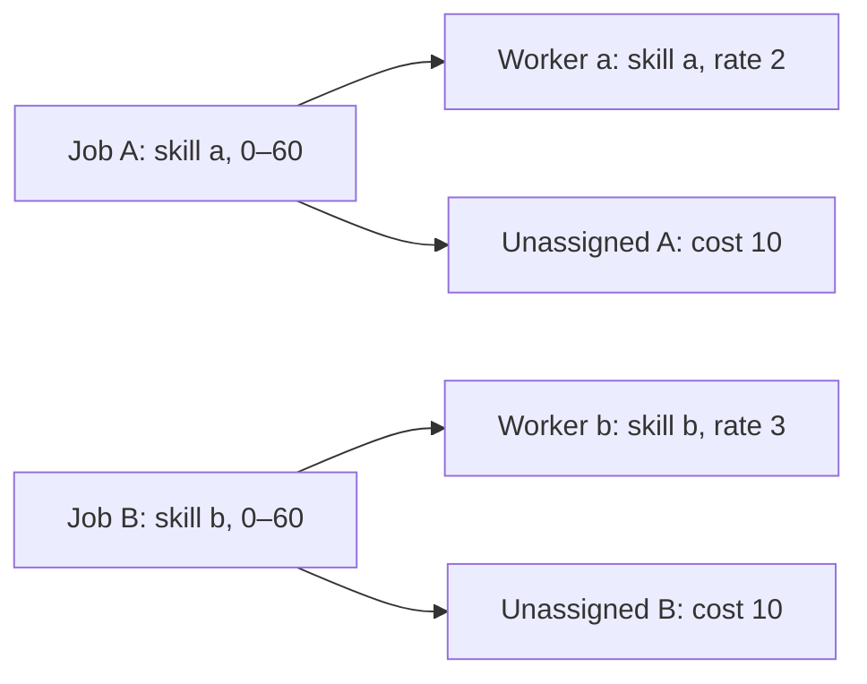

# Worked example: two workers, two jobs, all 16 states

This synthetic example is small enough to check by hand. Its input is
`data/synthetic/m2/mini_example.json`; its objective configuration is
`configs/m2_mini_example.json`. Costs below are integer minor monetary units.



## Original instance and optimum

| Entity | Skills | Interval | Capacity | Hourly rate |
| --- | --- | --- | ---: | ---: |
| `worker-a` | a | available `[0,60)` | 60 | 2 |
| `worker-b` | b | available `[0,60)` | 60 | 3 |
| `job-a` | requires a | `[0,60)` | — | — |
| `job-b` | requires b | `[0,60)` | — | — |

Both jobs are optional, priority one, with default omission penalty 10. Cost
weight is one and imbalance weight is zero. Assigning A costs 2; assigning B
costs 3. Distinct skills force each assignment. Workers can each execute their
one eligible job without overlap or workload violation. The unique optimal
schedule assigns both jobs, with M1 objective `2+3=5`.

## Canonical variables and constraints

| Index | Bit | Meaning |
| ---: | --- | --- |
| 0 | `x_A` | assign job-a to worker-a |
| 1 | `x_B` | assign job-b to worker-b |
| 2 | `u_A` | omit job-a |
| 3 | `u_B` | omit job-b |

Pruning removes two of the four worker/job combinations due to skills. No slack
bits are required: each worker's sum of eligible durations already equals its
cap. Coverage requires `x_A+u_A=1` and `x_B+u_B=1`. Other constraints are enforced
by the eligible mapping or are redundant here. Serialized `1100` means indices
0 and 1 are selected; it is not a reversed SDK bitstring.

The feasible business bound is `max(2,10)+max(3,10)=20`. With margin one,
`P=21` exceeds that bound. Thus:

```text
business = 2*x_A + 3*x_B + 10*u_A + 10*u_B
coverage = 21*(x_A+u_A-1)**2 + 21*(x_B+u_B-1)**2
Q = business + coverage
  = 42 - 19*x_A - 18*x_B - 11*u_A - 11*u_B
       + 42*x_A*u_A + 42*x_B*u_B
```

The constant is retained; removing it would shift all energies by 42.

## Upper-triangular Q matrix

`Q(v)=v.T M v+42`, for `v=(x_A,x_B,u_A,u_B)`:

| M | x_A | x_B | u_A | u_B |
| --- | ---: | ---: | ---: | ---: |
| x_A | -19 | 0 | 42 | 0 |
| x_B | 0 | -18 | 0 | 42 |
| u_A | 0 | 0 | -11 | 0 |
| u_B | 0 | 0 | 0 | -11 |

An off-diagonal 42 appears once, above the diagonal; do not halve it or count it
twice. For each job, the local energies are:

| Assignment / unassigned bits | Job A energy | Job B energy | Meaning |
| --- | ---: | ---: | --- |
| 00 | 21 | 21 | Missing coverage |
| 10 | 2 | 3 | Assigned |
| 01 | 10 | 10 | Explicitly unassigned |
| 11 | 33 | 34 | Both assigned and unassigned |

## Complete state table

| Bits `x_A x_B u_A u_B` | Business | Coverage | Total Q | M1 valid? |
| --- | ---: | ---: | ---: | --- |
| 0000 | 0 | 42 | 42 | no |
| 0001 | 10 | 21 | 31 | no |
| 0010 | 10 | 21 | 31 | no |
| 0011 | 20 | 0 | 20 | yes, omit both |
| 0100 | 3 | 21 | 24 | no |
| 0101 | 13 | 42 | 55 | no |
| 0110 | 13 | 0 | 13 | yes, assign B |
| 0111 | 23 | 21 | 44 | no |
| 1000 | 2 | 21 | 23 | no |
| 1001 | 12 | 0 | 12 | yes, assign A |
| 1010 | 12 | 42 | 54 | no |
| 1011 | 22 | 21 | 43 | no |
| **1100** | **5** | **0** | **5** | **yes, assign both** |
| 1101 | 15 | 21 | 36 | no |
| 1110 | 15 | 21 | 36 | no |
| 1111 | 25 | 42 | 67 | no |

The unique ground state is `1100`, energy 5. The next energy is 12, giving
first-excited gap 7. There are four valid and twelve invalid states. The best
invalid state is `1000`, energy 23, so the invalid-state margin above ground
is 18. These are complete enumeration facts, not a selected favorable sample.

## Decode, validate and independently score

`decode_bitstring` translates `1100` literally:

```json
{
  "instance_id": "m2-mini-example",
  "assignments": [
    {"job_id": "job-a", "worker_id": "worker-a"},
    {"job_id": "job-b", "worker_id": "worker-b"}
  ],
  "unassigned_job_ids": []
}
```

The unchanged M1 validator finds correct coverage, skills, availability,
nonoverlap per worker, and loads of 60 minutes within each cap: valid, zero
violations. The unchanged evaluator computes omission 0, cost 5, imbalance 0,
total 5. CP-SAT and the M1 exhaustive oracle both prove optimum 5. The exact
QUBO optimum therefore agrees with the classical optimum.

## Ising representation

With `x_i=(1-z_i)/2`:

```text
4H = 134 - 4*z_A - 6*z_B - 20*z_uA - 20*z_uB
         + 42*z_A*z_uA + 42*z_B*z_uB
```

Physical coefficients divide by four: constant `67/2`, fields
`(-1,-3/2,-5,-5)`, and couplings `21/2` on pairs `(0,2)` and `(1,3)`.
The serialized representation retains numerator integers and denominator four.
`1100` maps to spins `(-1,-1,+1,+1)`:

```text
4H = 134 + 4 + 6 - 20 - 20 - 42 - 42 = 20
H = 20/4 = 5 = Q(1100)
```

The exact substitution also reproduces every other energy in the 16-state
table. The offset is essential; there is no approximation tolerance.

## Reproduce

```sh
uv run --locked python -m km_quantum qubo encode --instance data/synthetic/m2/mini_example.json --config configs/m2_mini_example.json --output results/m2-mini-qubo.json
uv run --locked python -m km_quantum qubo inspect --model results/m2-mini-qubo.json --matrix
uv run --locked python -m km_quantum qubo solve-exhaustive --instance data/synthetic/m2/mini_example.json --model results/m2-mini-qubo.json --output results/m2-mini-ground.json
uv run --locked python -m km_quantum qubo verify --instance data/synthetic/m2/mini_example.json --model results/m2-mini-qubo.json --output results/m2-mini-verification.json --benchmark-output results/m2-mini-benchmark.jsonl --experiment-id m2-mini
uv run --locked python -m km_quantum qubo to-ising --model results/m2-mini-qubo.json --output results/m2-mini-ising.json
```
