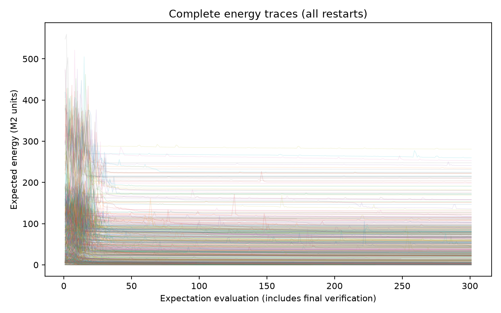
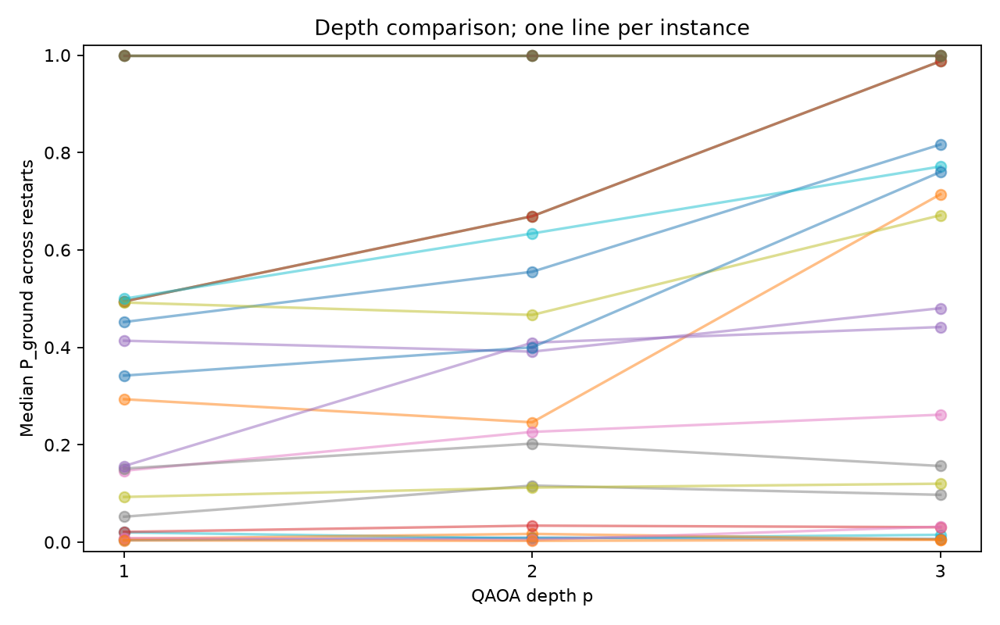
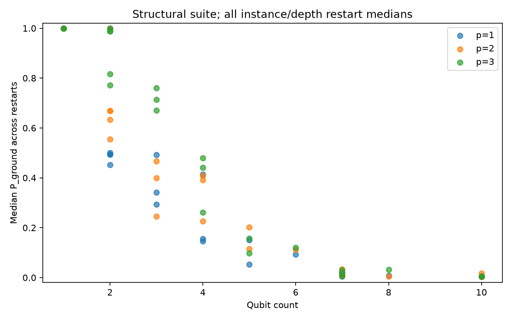
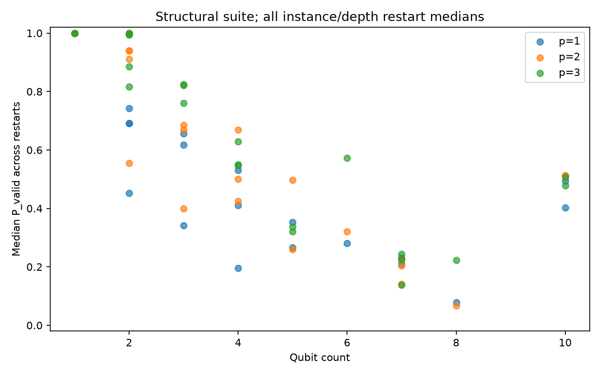
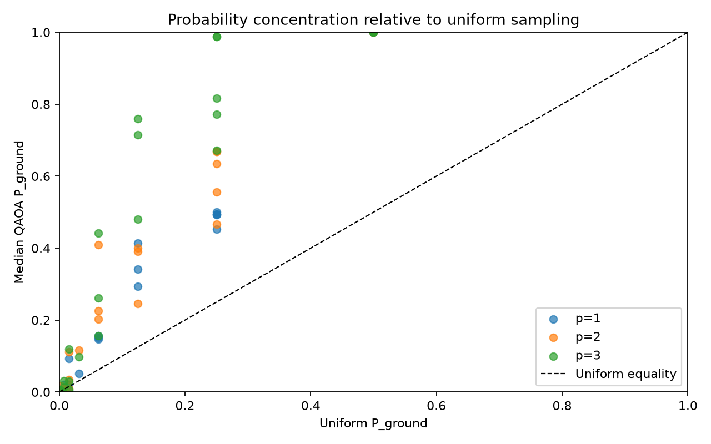

# M3 completion report — ideal standard QAOA

## Executive Summary

**M3 acceptance: PASS.** The complete fixed study contains 660 runs with no execution failures: 90 development and 570 evaluation runs. M2 remains frozen. The prerequisite operator and ordering gate checks all 14,246 basis states of the 113 eligible references with zero energy mismatches. The 79 protected M1/M2 files retain exact byte identity, and all final expectation and ground-frequency audits pass.

M2 established that scheduling is encoded correctly; M3 measures what standard QAOA does on those encodings under ideal local simulation. It begins at uniform superposition, uses the standard X mixer, trains through exact V2 expectation evaluation and fixed-budget COBYLA, retains ten random restarts, and analyzes the complete final distribution before ideal sampling.

The quality result is mixed. Across evaluation runs, pooled median ground probability is 0.307291 and median lift over uniform is 2.165724. Larger depth improves aggregate quality, but it does not improve every instance or seed. Larger cases often retain little ground mass; five instance/depth groups have a restart median below uniform. Only 148 of 660 restarts converge before the fixed budget; all 512 budget terminations remain in the results.

The 22 selected reference IDs represent 20 distinct indexed Ising Hamiltonians. Evaluation has 19 IDs but only 17 distinct Hamiltonians. These small dependent synthetic observations support descriptive findings, not a general scaling law, causal structural claim, practical advantage or quantum-advantage claim. CP-SAT remains the business-objective oracle; complete frozen M2 ground sets remain the quantum-energy oracle.

The authoritative evidence is the [acceptance report](../results/m3/m3-acceptance.json), [execution record](../results/m3/benchmark_execution.json), and [complete descriptive analysis](../results/m3/report_analysis.json). Acceptance concerns correctness and complete reporting rather than good QAOA performance.

## Quantum Implementation

The environment pins Qiskit 2.5.2, the stable installable release verified on
PyPI before implementation on 11 October 2026. PyPI lists a Windows x86-64
wheel and Python >=3.10; this project uses Python 3.12.15. The newer 2.6.0rc1
listed at discovery was a prerelease. The dependency lock and run metadata
identify the exact execution environment. [Qiskit on PyPI](https://pypi.org/project/qiskit/)

The visible algorithm uses `qiskit.circuit.library.qaoa_ansatz`, local V2
`StatevectorEstimator` and `StatevectorSampler`, `Statevector`, `SparsePauliOp`,
NumPy, and SciPy `minimize`. The state begins at `|+>^n`, prepared by Hadamard
gates. Each repetition applies the cost evolution `exp(-i gamma H_C)`, followed
by `exp(-i beta sum_i X_i)`. Supported depths are `p=1,2,3`. No classical
solution enters the initial state. [QAOA ansatz API](https://quantum.cloud.ibm.com/docs/en/api/qiskit/qiskit.circuit.library.qaoa_ansatz)

Construction reads the actual `circuit.parameters` objects and binds a mapping
from these objects to finite numeric values. Every result records each
parameter's name, position, initial value, and final value. In the pinned SDK,
ordinary circuits expose `beta[0],...,beta[p-1]` followed by
`gamma[0],...,gamma[p-1]`; correctness relies on returned objects rather than
assuming this ordering. Artifact names retain the SDK's Greek beta/gamma
characters. Logical depth and gate counts follow three decomposition passes,
with no hardware target or routing. [Tagged QAOA source](https://github.com/Qiskit/qiskit/blob/2.5.2/qiskit/circuit/library/n_local/qaoa_ansatz.py),
[parameter-order source](https://github.com/Qiskit/qiskit/blob/2.5.2/qiskit/circuit/quantumcircuit.py)

An empty model or constant Hamiltonian has no useful variational objective.
These explicit edge cases use a uniform, parameter-free circuit, run no
optimizer calls, and record one final verification evaluation. The empty
assignment has probability one for a zero-qubit model. A zero observable is
evaluated analytically because the pinned Estimator rejects an empty
observable; its scalar offset remains in the reported energy.

The cost function evaluates the bound, unmeasured circuit through
`StatevectorEstimator(default_precision=0.0)` and adds the offset. For the
unitary circuits used here, training is exact ideal simulation up to floating
arithmetic and contains no shot noise. Each call is written to a JSONL trace
with its sequential evaluation index, parameter vector, raw observable
expectation, offset-inclusive energy, monotonic elapsed time, duration, and
phase. [StatevectorEstimator API](https://quantum.cloud.ibm.com/docs/en/api/qiskit/qiskit.primitives.StatevectorEstimator)

The optimizer is SciPy COBYLA. A nontrivial budget below
`parameter_count+2` is rejected because SciPy would otherwise increase an
insufficient COBYLA budget. One separately logged final verification call lies
outside the optimizer budget. Nonconverged restarts remain observations;
optimizer success, termination message, and actual call counts are preserved.

After optimization, `Statevector.from_instruction` computes the complete final
probability vector. Every basis state is associated with its unchanged M2
QUBO/Ising energy, decoded M1 validity, encoded constraint validity, decoded
objective, and membership in the complete saved ground set. The estimator
energy is independently checked against the probability-weighted M2 energy,
including the offset. [Statevector API](https://quantum.cloud.ibm.com/docs/en/api/qiskit/qiskit.quantum_info.Statevector)

Ground probability sums all frozen minimum encodings. Decoded schedule
validity differs from encoded constraint validity: incorrect slack or
auxiliary bits can decode to a valid, even optimal, primary schedule while
the full encoding has energy above the minimum. Results separately report
decoded optimum probability and energy-consistent optimal-valid probability.
The latter is checked against ground probability. The analysis preserves the
auxiliary distinction instead of counting every optimal primary decode as a
Hamiltonian minimum.

Finite shots occur only after exact training. A copy of the final circuit
receives final measurements and runs through seeded V2 `StatevectorSampler`.
The sampler checks the declared ground probability against the supplied final
circuit. Counts pass through the central ordering layer and are checked for
positive integer frequencies and the declared shot total.
[StatevectorSampler API](https://quantum.cloud.ibm.com/docs/en/api/qiskit/qiskit.primitives.StatevectorSampler)

Sampling reports the best sampled energy, modal state, all ground samples,
validity and encoded-validity frequencies, decoded optimum observations, and
the best decoded M1 objective. Ground frequency is audited using a two-sided
exact binomial test against the final exact ground mass, with prespecified
rejection level `1e-9`. A 95% binomial confidence interval and theoretical
standard error `sqrt(p*(1-p)/N)` are saved. This tests ground frequency; it is
not an omnibus test of every basis-state frequency.

## M2 → Qiskit Verification

The adapter translates the frozen M2 representation directly. M2 serializes
four times the physical Hamiltonian through integer `constant4`, field
coefficients, and coupling coefficients. The adapter divides by four and
constructs only `h_i Z_i` and `J_ij Z_i Z_j` terms. It does not re-derive
penalties or the scheduling encoding. `SparsePauliOp.from_sparse_list`
specifies affected qubits explicitly. The scalar constant is held separately
as `energy_offset`, excluded from cost evolution, and restored for every
energy comparison. Conversion rejects coefficients or offsets that cannot
be represented exactly as finite doubles and rejects an absolute energy bound
that could overflow. [SparsePauliOp API](https://quantum.cloud.ibm.com/docs/en/api/qiskit/qiskit.quantum_info.SparsePauliOp)

One ordering layer maps M2 variable `x[i]` to Qiskit qubit `q[i]`. M2 strings
place index zero at the left; Qiskit displayed measurement strings place it
at the right. Basis index `k` maps to `x[i]=(k >> i) & 1`, or equivalently
`k=sum_i x[i]*2**i`. Named conversion functions implement both directions and
reject malformed bits, indices, and dimensions. Decoder, analysis, and
sampling code use this layer. [IBM bit-ordering guide](https://quantum.cloud.ibm.com/docs/en/guides/bit-ordering)

The prerequisite gate checked every computational basis state of every
reference at or below the cap, including invalid encodings. For each state,
a Qiskit `Statevector` expectation plus the offset was compared with the exact
M2 Ising energy. QAOA implementation and quality experiments began only after
this gate passed.

| Operator gate evidence | Result |
| --- | --- |
| Frozen M2 references | 114 |
| References within cap | 113 |
| Full basis states checked | 14,246 |
| Mismatches | 0 |
| Maximum absolute difference | 0.0 |
| Central absolute tolerance | `1e-9` |
| Central relative tolerance | `1e-12` |
| Excluded reference | Hand case O, 15 qubits |
| Raw initial gate record | `results/m3/operator-equivalence.json` |

Independent fixtures cover a single Z field, asymmetric fields, ZZ couplings,
quarter-valued offsets, malformed ordering, and zero-dimensional models.
Additional tests multiply analytic cost phases and X-rotation matrices to
calculate one- and two-qubit complex amplitudes at `p=1,2,3`. Their expected
answers do not reuse Qiskit circuit construction. This verifies the sign,
ordering, parameter binding, and standard mixer independently.

The benchmark repeats this gate in [operator_gate.json](../results/m3/operator_gate.json). Final estimator versus probability-weighted M2 energy passes in all 660 runs; the largest absolute discrepancy is 1.307398633798584e-12. The largest difference between complete ground and energy-consistent optimal-valid mass is 0.0. These checks include every final basis probability and every frozen minimum.

The gate validates reconstructed M2 acceptance and provenance: 79 protected files, no changed files, no line-ending-only differences, unchanged acceptance bytes, and unchanged mathematics.


## Benchmark Suite

The manifest is `data/synthetic/m3/benchmark_manifest.json`. Selection precedes
quality observation and uses structural data and instance hashes. The primary
suite contains all 13 hand references within the cap, plus one random reference
at each available qubit count `1,2,3,4,5,6,7,8,10`. Within each random-size
group, the smallest SHA-256 of the full instance ID wins. The manifest records
source record identities, source line, canonical record and model hashes,
qubit count, all-ground-state count, ground energy, invalid-encoding margin,
and existing M2 structure metrics.

The conservative cap is 14 qubits. At the cap, a complex128 amplitude vector
alone uses 262,144 bytes, with additional simulator and Python overhead. The
selected suite actually spans 1–10 qubits. All other eligible references
remain in correctness verification. The 15-qubit hand case O is excluded
explicitly; no claim is made about QAOA quality on it.

`int(SHA256(instance_id),16) % 5 == 0` assigns development; all other residues
assign evaluation. This produces three development and 19 evaluation primary
instances. Technical debugging may use development; evaluation cannot justify
changing settings to improve observed quality. The split is protocol
separation within synthetic M2 fixtures, not a claim of new unseen scheduling
data.

| Frozen reference | Qubits | Ground encodings | Split |
| --- | ---: | ---: | --- |
| `A_single_job` | 2 | 1 | evaluation |
| `B_two_workers_cost` | 3 | 1 | development |
| `C_skill_compatibility` | 2 | 1 | evaluation |
| `D_availability` | 2 | 1 | evaluation |
| `E_overlap` | 4 | 2 | development |
| `F_unassigned_override` | 1 | 1 | evaluation |
| `G_priority` | 4 | 1 | evaluation |
| `H_workload` | 5 | 2 | evaluation |
| `I_multiple_optima` | 3 | 2 | evaluation |
| `J_combined_constraints` | 7 | 1 | evaluation |
| `K_bounded_slack` | 7 | 2 | evaluation |
| `M_active_imbalance` | 10 | 2 | evaluation |
| `N_zero_override` | 2 | 2 | evaluation |
| `random-011` | 7 | 2 | evaluation |
| `random-013` | 4 | 1 | evaluation |
| `random-019` | 1 | 1 | evaluation |
| `random-027` | 8 | 2 | development |
| `random-041` | 5 | 1 | evaluation |
| `random-045` | 6 | 1 | evaluation |
| `random-064` | 2 | 1 | evaluation |
| `random-084` | 3 | 1 | evaluation |
| `random-090` | 10 | 1 | evaluation |

The selection controls simulation and optimization cost before results are
known. It is not a representative random sample of practical scheduling.
The plan contains `22*3*10=660` primary runs, including 90 development and
570 evaluation runs.

All 660 planned runs completed. No IDs or seeds are removed. Exact indexed Hamiltonian identity includes qubit count, denominator, constant, fields and couplings without qubit-permutation reduction. C_skill_compatibility/D_availability and F_unassigned_override/random-019 are duplicate pairs. Thus there are 20 distinct Hamiltonians overall and 17 among 19 evaluation IDs. Repeated instances across depths and shared sampling seeds add dependence.

All eligible frozen references within the cap actually have at most ten qubits. The cap permits fourteen, but this study has no observations at eleven through fourteen.

## QAOA Configuration

| Setting | Fixed primary value |
| --- | --- |
| Initial state | Uniform `|+>^n` |
| Cost Hamiltonian | Frozen M2 Ising fields and couplings |
| Scalar offset | Excluded from circuit; added to every energy |
| Mixer | `sum_i X_i` |
| Depths | `p=1,2,3` |
| Parameters | Actual Qiskit objects; normally `2*p` |
| Empty/constant exception | Uniform parameter-free circuit, no optimizer |
| Initialization | `numpy.default_rng(seed).uniform(0,pi,actual_parameter_count)` |
| Initialization seeds | `0,1,2,3,4,5,6,7,8,9` |
| Restarts | 10 per selected instance and depth |
| Training primitive | `StatevectorEstimator(default_precision=0.0)` |
| Optimizer | SciPy COBYLA |
| Optimizer budget | At most 300 objective evaluations |
| Optimizer tolerance | `1e-6` |
| Initial trust-region radius | `rhobeg=0.5` |
| Final verification | One separately logged call outside optimizer budget |
| Hamiltonian rescaling | None |
| Post-training shots | 1024 |
| Sampler seed | `10000 + initialization_seed + 100*p` |
| Verification tolerance | `atol=1e-9`, `rtol=1e-12` |
| Descriptive probability success | Strictly `P_ground > 0.5` |
| Ground-frequency rejection level | Exact two-sided binomial test, `1e-9` |
| Sampling interval | 95% binomial interval |
| Primary qubit cap | 14 |

Initialization uses the half-open interval `[0,pi)`. All initial and final
angle vectors are saved. No budget, tolerance, seed, penalty, Hamiltonian
scaling, or selection change is justified by final evaluation quality.

## Results

All restarts are retained. The tables below report medians over pooled individual runs within each stated split or split/depth. These differ from medians of instance medians, reported in Depth Analysis. Raw energy is meaningful for each frozen model; pooled mean raw energy across heterogeneous instances is descriptive rather than a common objective scale.

Normalized error is (E−E_ground)/(E_max−E_ground), with zero for a constant energy span. Raw energy and residual are retained. Uniform ground probability is g/2^n, and lift compares complete ground mass with this baseline. Offset-sensitive energy ratios are not used.

| Split | Completed runs | Median error | Median P_ground | Median P_valid | Median lift | Converged |
| --- | --- | --- | --- | --- | --- | --- |
| development | 90 | 0.127447 | 0.263892 | 0.525242 | 2.673205 | 15/90 |
| evaluation | 570 | 0.160308 | 0.307291 | 0.533090 | 2.165724 | 133/570 |

| Split/depth | Runs | Mean raw energy | Median error | Median P_ground | Median P_valid | Median lift | P_ground > 0.5 | Converged |
| --- | --- | --- | --- | --- | --- | --- | --- | --- |
| development/p1 | 30 | 84.155387 | 0.152280 | 0.232830 | 0.499702 | 2.473722 | 4/30 | 15/30 |
| development/p2 | 30 | 76.151457 | 0.141975 | 0.208705 | 0.565583 | 2.245218 | 3/30 | 0/30 |
| development/p3 | 30 | 63.811041 | 0.095611 | 0.352516 | 0.629236 | 4.165943 | 12/30 | 0/30 |
| evaluation/p1 | 190 | 40.660720 | 0.203976 | 0.212910 | 0.489913 | 2.000000 | 39/190 | 73/190 |
| evaluation/p2 | 190 | 35.840594 | 0.157980 | 0.282335 | 0.534679 | 2.366159 | 76/190 | 30/190 |
| evaluation/p3 | 190 | 33.299833 | 0.128827 | 0.418787 | 0.598086 | 3.155914 | 92/190 | 30/190 |

Across all 660 runs, pooled median ground probability is 0.288846 and median valid probability is 0.531375. The strict ground-probability criterion is met by 226 runs; 577 runs are above uniform and 83 below. Evaluation has 207/570 runs above 0.5 and 503/570 above uniform. These are descriptive counts, not independent observations.

The complete [66 restart summaries](../results/m3/summaries/restarts.json) retain count, mean, median, sample standard deviation, best/worst energy, normalized error, ground mass, threshold rate, convergence and runtime distributions. The [report analysis](../results/m3/report_analysis.json) adds complete validity, decoded optimum, circuit and structural diagnostics. The appendix covers every group.

Ideal sampling totals 675,840 shots across 660 records. All 660 ground-frequency binomial audits pass at alpha=1e-9. The smallest two-sided p-value is 0.002607933; the largest absolute empirical-versus-exact ground-frequency discrepancy is 0.042173390. Ground encodings are observed in 649 runs and optimal primary schedules decoded in 659 runs. Eleven records miss all ground encodings at 1024 shots. Exact ground mass and seeded frequency are distinct measurements.

Empirical feasibility and decoded objectives are recorded without a separate formal validity-frequency audit. Formal sampling inference concerns ground counts only. Expected-energy checks pass in all runs, with largest absolute difference 1.307398634e-12; complete ground and energy-consistent optimum masses agree exactly.

In 240 runs, decoded-optimal mass exceeds ground mass because nonoptimal auxiliary encodings can decode to optimal primary schedules. For M_active_imbalance at p=1/2/3, restart-median decoded-optimum mass is 0.344252/0.437585/0.288540, ground mass 0.006781/0.016986/0.005450, encoded-valid mass 0.028382/0.035140/0.026520, and decoded validity 0.494239/0.511270/0.477813. These quantities answer different questions.

Five plots were regenerated from saved data and visually inspected. The convergence overlay includes optimizer evaluations and final verification calls. Its heterogeneous raw energy scales support coverage inspection, not individual-instance comparison; raw traces supply that detail. Depth and scaling plots show per-instance restart medians, with duplicate Hamiltonians overlapping.












## Depth Analysis

Quality columns below are medians of each instance's ten-restart median. Runtime is a pooled run median; nfev is a pooled run mean. These aggregation units differ from pooled quality medians in Results.

| Split | p | IDs | Median instance error | Median instance P_ground | Median instance P_valid | Median core runtime s | Mean nfev | Converged |
| --- | --- | --- | --- | --- | --- | --- | --- | --- |
| development | 1 | 3 | 0.126941 | 0.293449 | 0.530616 | 2.831413 | 247.433333 | 15/30 |
| development | 2 | 3 | 0.113382 | 0.246088 | 0.668765 | 3.348955 | 300.000000 | 0/30 |
| development | 3 | 3 | 0.094545 | 0.480359 | 0.629236 | 3.914535 | 300.000000 | 0/30 |
| evaluation | 1 | 19 | 0.197486 | 0.156191 | 0.410193 | 1.357496 | 231.342105 | 73/190 |
| evaluation | 2 | 19 | 0.170490 | 0.400066 | 0.511270 | 1.668155 | 267.626316 | 30/190 |
| evaluation | 3 | 19 | 0.134375 | 0.441736 | 0.572170 | 1.667737 | 268.347368 | 30/190 |

Paired comparisons use the same nominal ID at both depths. Absolute changes within 1e-9 are near ties. Lower error is better; the last column always reports signed later-minus-earlier change. These are descriptive comparisons of dependent IDs.

| Split | Depth change | Metric | Improved | Worsened | Near ties | Median signed change |
| --- | --- | --- | --- | --- | --- | --- |
| development | 1 → 2 | P_ground | 0 | 3 | 0 | -0.022430 |
| development | 1 → 2 | error | 2 | 1 | 0 | -0.005740 |
| development | 2 → 3 | P_ground | 3 | 0 | 0 | 0.089150 |
| development | 2 → 3 | error | 3 | 0 | 0 | -0.036370 |
| development | 1 → 3 | P_ground | 3 | 0 | 0 | 0.066719 |
| development | 1 → 3 | error | 3 | 0 | 0 | -0.042110 |
| evaluation | 1 → 2 | P_ground | 13 | 3 | 3 | 0.019250 |
| evaluation | 1 → 2 | error | 14 | 2 | 3 | -0.024229 |
| evaluation | 2 → 3 | P_ground | 11 | 5 | 3 | 0.007377 |
| evaluation | 2 → 3 | error | 12 | 4 | 3 | -0.016285 |
| evaluation | 1 → 3 | P_ground | 14 | 2 | 3 | 0.027211 |
| evaluation | 1 → 3 | error | 16 | 0 | 3 | -0.040514 |

Across all 22 IDs, p1→p2 improves ground mass for 13, worsens six, and ties three. p2→p3 improves 14, worsens five, and ties three. p1→p3 improves 17, worsens two, and ties three. Normalized error improves for 19 and ties three from p1 to p3. Numerically saturated tiny cases are near ties rather than improvements.

Aggregate energy quality and ground mass improve with depth under this protocol, but monotonic ground-mass improvement is not universal. M_active_imbalance reduces median error from 0.170490 at p2 to 0.156773 at p3 while its median ground probability falls from 0.016986 to 0.005450. H_workload and K_bounded_slack also lose ground mass from p2 to p3.

The budget stays at 300 evaluations while parameter count grows from two to six. Overall convergence is 88/220, 30/220, and 30/220 at p1/p2/p3. A more expressive circuit therefore faces a less adequate effective budget; no setting is retuned after evaluation.

For M_active_imbalance at p1/p2/p3, logical depth is 33/56/79, total gates 84/158/232, one-qubit gates 48/86/124, and two-qubit gates 36/72/108. Circuit cost grows even when ground mass does not. These are decomposed logical counts without hardware compilation or routing; the appendix and JSON contain every group's circuit counts.

## Initialization Sensitivity

Ten seeds produce substantial variability, including on three-qubit models. I_multiple_optima at p3 has the widest ground-probability spread: 0.057140–0.984098, range 0.926959 and sample std 0.324834. Its median is 0.671186; showing only the best seed would misrepresent typical behavior.

| Reference | Split | p | Minimum P_ground | Median | Maximum | Sample std |
| --- | --- | --- | --- | --- | --- | --- |
| I_multiple_optima | evaluation | 3 | 0.057140 | 0.671186 | 0.984098 | 0.324834 |
| random-084 | evaluation | 1 | 0.002753 | 0.341972 | 0.826400 | 0.230851 |
| B_two_workers_cost | development | 3 | 0.144117 | 0.714303 | 0.936742 | 0.264760 |
| I_multiple_optima | evaluation | 2 | 0.135426 | 0.466582 | 0.874641 | 0.221011 |

Every fixed seed for I_multiple_optima at p3 is shown below:

| Seed | P_ground | Normalized error | nfev | Converged |
| --- | --- | --- | --- | --- |
| 0 | 0.680268 | 0.068629 | 300 | False |
| 1 | 0.530057 | 0.112885 | 300 | False |
| 2 | 0.937956 | 0.023845 | 300 | False |
| 3 | 0.662103 | 0.072651 | 300 | False |
| 4 | 0.802008 | 0.038611 | 300 | False |
| 5 | 0.057140 | 0.203976 | 300 | False |
| 6 | 0.895029 | 0.028158 | 300 | False |
| 7 | 0.095007 | 0.184562 | 300 | False |
| 8 | 0.583005 | 0.093272 | 300 | False |
| 9 | 0.984098 | 0.003543 | 300 | False |

All initial/final vectors, termination messages and complete traces are retained. COBYLA reaches its lower trust-region radius in 148 runs and MAXFUN in 512. MAXFUN is a budget termination rather than an execution failure or missing observation. Its quality remains included. No seeds are selected or repeated until successful.

## Scaling

The table reports medians of per-instance restart medians across both splits at each size, retaining duplicates. It differs from pooled run medians in Results.

| Qubits | IDs | P_ground p1 | P_ground p2 | P_ground p3 | P_valid p3 |
| --- | --- | --- | --- | --- | --- |
| 1 | 2 | 1.000000 | 1.000000 | 1.000000 | 1.000000 |
| 2 | 5 | 0.494295 | 0.669265 | 0.987538 | 0.995231 |
| 3 | 3 | 0.341972 | 0.400066 | 0.714303 | 0.821376 |
| 4 | 3 | 0.156191 | 0.391210 | 0.441736 | 0.549406 |
| 5 | 2 | 0.101610 | 0.159242 | 0.126761 | 0.328481 |
| 6 | 1 | 0.092768 | 0.112018 | 0.119980 | 0.572170 |
| 7 | 3 | 0.020012 | 0.009146 | 0.015035 | 0.224904 |
| 8 | 1 | 0.008512 | 0.004677 | 0.031662 | 0.223159 |
| 10 | 2 | 0.005168 | 0.009820 | 0.005102 | 0.492248 |

Ground mass is much smaller among the seven-, eight-, and ten-qubit groups than among the smallest cases. At ten qubits, median-of-instance-medians ground mass is 0.005168/0.009820/0.005102 at p1/p2/p3. Greater depth does not reverse the difficulty of the two ten-qubit references. Decoded feasibility can remain near one half while exact ground probability remains below one percent.

The size trend is not monotonic at every size, and structural features vary together. Evaluation size correlations with instance-median ground mass are −0.817586/−0.880285/−0.905143 at p1/p2/p3. These are descriptive associations, not a causal scaling law. There is no selected nine-qubit case or eleven-to-fourteen-qubit observation, and the 15-qubit case is excluded.

Pooled median core runtime at ten qubits is 2.495/3.163/3.453 seconds; the single eight-qubit reference takes 4.380/5.236/6.161 seconds. Circuit structure and optimizer behavior matter beyond size. Core runtime excludes separate sampling, suite gates, output outside the core call and plots. It is classical statevector runtime, not QPU time.

## Structural Observations

This analysis addresses prespecified questions without new optimization, configuration changes, filtering or rescaling. It uses one ten-restart median per original reference/depth, separately by split. The complete [exploratory analysis](../results/m3/summaries/exploratory_correlations.json) and [supplemental constraint measurements](../results/m3/constraint_structure_analysis.json) preserve all correlations and undefined cases.

Atomic constraint count measures individual encoded penalty equations/terms: coverage per job, mandatory omission per mandatory job, overlap per eligible overlapping job pair/worker, workload per stored workload-slack group, and imbalance per upper/lower slack group plus the load-range equation when present. It excludes skill/availability predicates already handled by frozen pruning. Active component type count instead counts which penalty families occur. Examples of atomic counts are A=2, H=3, M=6.

Coefficient dynamic range is maximum/minimum absolute nonzero aggregate linear or quadratic coefficient, excluding the constant. Density is nonzero quadratic terms divided by possible pairs. Invalid-energy margin is minimum invalid-encoding energy minus ground energy. Slack count counts slack variables separately from auxiliaries. Penalty/business ratio is the common frozen penalty divided by the largest absolute nonzero nonconstant business coefficient, measured rationally as a scale feature.

The evaluation Pearson coefficients below concern instance-median ground/valid mass. Values in each cell are ordered p1 / p2 / p3.

| Feature | r(P_ground), p1 / p2 / p3 | r(P_valid), p1 / p2 / p3 |
| --- | --- | --- |
| Qubit count | −0.817586 / −0.880285 / −0.905143 | −0.647327 / −0.696074 / −0.785168 |
| Atomic encoded constraint count | −0.802339 / −0.854342 / −0.869681 | −0.693916 / −0.749512 / −0.759641 |
| QUBO density | +0.129218 / +0.183611 / +0.292884 | +0.226432 / +0.320596 / +0.276758 |
| Coefficient dynamic range | −0.212942 / −0.152964 / −0.094025 | −0.127439 / −0.016264 / −0.146909 |
| Invalid-energy margin | −0.634242 / −0.604119 / −0.579035 | −0.695426 / −0.691733 / −0.590501 |
| Slack variable count | −0.558389 / −0.629357 / −0.668994 | −0.340260 / −0.383999 / −0.565502 |
| Penalty/business coefficient ratio | −0.452131 / −0.514580 / −0.568476 | −0.376288 / −0.427978 / −0.563109 |

Size and atomic constraint count have strong negative associations with ground mass. Density and coefficient range are weaker. Invalid margin correlates negatively with validity: a larger correctness gap does not imply easier optimization under this fixed setup. Correct encoding separation and variational optimization are different properties.

The first six features use 19 evaluation IDs/17 distinct indexed Hamiltonians. Penalty/business ratio excludes N_zero_override because its business polynomial has no nonzero nonconstant coefficient, leaving 18 IDs/16 distinct Hamiltonians. No requested evaluation correlation is null. Development has only three IDs; constant inputs/outcomes yield null correlations, including assignment count and p2/p3 convergence.

Size, slack, density, constraints and scales are confounded. Duplicates and repeated instances are dependent. These correlations support no independent-sample significance, causal or generalization claim. Supplemental scripts measure frozen structures and do not alter them.

## Negative Results

Five of 66 groups have restart-median ground mass below uniform; none is removed:

| Reference | Split | p | Median P_ground | Uniform P_ground | Median lift |
| --- | --- | --- | --- | --- | --- |
| J_combined_constraints | evaluation | 2 | 0.007658 | 0.007812 | 0.980241 |
| K_bounded_slack | evaluation | 1 | 0.004081 | 0.015625 | 0.261211 |
| K_bounded_slack | evaluation | 2 | 0.009146 | 0.015625 | 0.585362 |
| K_bounded_slack | evaluation | 3 | 0.006578 | 0.015625 | 0.421002 |
| random-027 | development | 2 | 0.004677 | 0.007812 | 0.598674 |

K_bounded_slack remains below uniform at all three depths. J_combined_constraints p2 is slightly below uniform, and random-027 p2 substantially below. Across individual runs, 83/660 are below uniform, including 67/570 evaluation runs.

M_active_imbalance p3 improves expected-energy error while worsening ground mass from p2. The largest seed spread occurs on three qubits, so small size does not ensure stability. All 512 budget terminations remain in the quality results. Eleven shot records miss all ground encodings, even though a decoded optimal primary schedule can sometimes appear with a wrong auxiliary encoding.

These are mixed or weak outcomes for standard QAOA on the frozen unscaled models at the fixed budget. Operator, ordering, expectation and ground-frequency audits pass. Settings were not changed to make the outcomes more favorable.

## Research Questions

| Question | Measured answer |
| --- | --- |
| RQ-M3.1: Can ground probability increase over uniform? | Yes often: 577/660 runs exceed uniform, including 503/570 evaluation runs; pooled evaluation median lift is 2.165724. Five groups and 83 individual runs remain below uniform. |
| RQ-M3.2: How variable are random initializations? | Substantially variable: I_multiple_optima p3 ranges 0.057140–0.984098 with sample std 0.324834. All ten seeds and budget terminations remain reported. |
| RQ-M3.3: How does depth change performance? | Aggregate quality improves but individual depth changes can worsen ground mass. Across 22 IDs, p1→p3 improves median ground mass for 17, worsens two, ties three; normalized error improves for 19, ties three. Only 30/220 runs converge at each of p2/p3. |
| RQ-M3.4: How does size change performance? | Larger selected cases have much less ground mass: the two ten-qubit references have median-of-instance-medians ground probability 0.005168/0.009820/0.005102. The trend is structurally confounded and is not a general scaling law. |
| RQ-M3.5: How much mass is valid? | Pooled evaluation median decoded validity is 0.489913/0.534679/0.598086 at p1/p2/p3. Decoded validity can exceed encoded/ground mass greatly: M_active_imbalance p3 has 0.477813 validity, 0.026520 encoded validity and 0.005450 ground mass. |
| RQ-M3.6: Which structures correlate with quality? | Size and atomic constraint count have strong negative ground-mass associations; slack and margin also correlate negatively. Density/coefficient range are weaker. Invalid margin correlates negatively with validity at all depths. Dependence/confounding prevent causal claims. |


## Limitations

The study uses small synthetic scheduling encodings and a structurally selected
subset of frozen M2 references. It does not estimate performance for a
representative population of practical schedules. The deterministic split is
protocol separation, and M2 fixtures already supported mathematical development.

Full statevector simulation and exhaustive distribution analysis require
resources that grow exponentially with qubit count. Reported runtime is local
classical simulation time; it establishes neither quantum hardware runtime
nor an advantage over a practical classical solver. Logical circuit counts
have no hardware topology, routing, native-gate compilation, or queue effects.

Only one optimizer configuration, one primary shot count, three small depths,
and ten deterministic seeds are studied. Fixed unscaled M2 coefficients may
make some optimization landscapes harder; preserving them prevents a result-
dependent redesign but limits what this experiment says about other methods.
The binomial audit validates ground-frequency plausibility rather than every
cell of the sampled distribution. Floating numerical checks use the stated
strict tolerances rather than a symbolic quantum simulation proof.

M3 includes no hardware, IBM Runtime, credentials, noise, warm start, custom
mixer, error mitigation, hybrid decomposition, or quantum-advantage test. All
such comparisons lie outside the completed implementation scope.

Evaluation has 19 IDs but only 17 distinct quantum problems. Shared seeds and repeated instances limit independence. The apparent size trend and strongest associations can reflect jointly varying features. Training minimizes expected energy, while ground probability is a separate quantity that can deteriorate even as energy improves.

## Reproducibility

The M2 reference commit is `f489b365ebb1bf814c3087bd80969045a7817fa7`.
All 660 training runs used clean execution commit `1f0cdd9f2dd4331a6b637ed24d7fb9d783460add`. Reporting commit `73fb027` adds supplemental scripts and presentation-only plot labels; numeric runs are unchanged. The manifest, provenance file,
dependency lock, protocol, and every run identify the frozen inputs and fixed
configuration. Run metadata includes Git commit and checkout state,
dependency-lock hash, platform, Python, Qiskit, SciPy, NumPy, model hashes,
reference ID, actual parameter mapping, and all seeds.

The captured raw SHA-256 hashes for 79 protected M1/M2 files are retained and
the local protected bytes are unchanged. A separate portability comparison
normalizes only CRLF to LF; it permits Git line-ending conversion and rejects
every other content change. Reports distinguish exact byte identity from
line-ending-only differences. Manifest hashes identify the original raw
snapshot.

The original ignored M2 acceptance report was absent from the recovered
checkout. The unchanged M2 acceptance logic reconstructed a PASS report; this
is documented as reconstruction, not presented as the original historical
report. Its bytes and hash are preserved explicitly at
`results/m2-acceptance.json`, with Git `-text` treatment so the report is an
opaque byte archive rather than a line-ending-normalized document.

| Identity | Value |
| --- | --- |
| M2 reference commit | `f489b365ebb1bf814c3087bd80969045a7817fa7` |
| M3 execution source commit | `1f0cdd9f2dd4331a6b637ed24d7fb9d783460add` |
| Original frozen JSONL raw SHA-256 | `3c3448e769920dcc6098eac89448e7b1e2ecd5d8268b302c8b2572e379fb2e52` |
| Frozen JSONL LF-normalized SHA-256 | `067c50fba661ee9621f8f510bcf63bcccb657605ebd070693961c045be61c45b` |
| Reconstructed M2 acceptance SHA-256 | `5734709f21813c9587f75aca7665871c8ac1dfe0423e82a56497323f0680ad20` |
| Manifest content SHA-256 | `f640fc3ee7cc843fd04724b45e0cb8c990a04b78c1571f4bcbb076060e620b45` |
| Protected hash map | `data/synthetic/m3/provenance.json` |
| Fixed study manifest | `data/synthetic/m3/benchmark_manifest.json` |
| Fixed protocol | `docs/m3_experiment_protocol.md` |

| Tool | Version used |
| --- | --- |
| Python | 3.12.15 |
| Qiskit | 2.5.2 |
| SciPy | 1.18.1 |
| NumPy | 2.5.3 |
| Matplotlib | 3.11.2 |
| OR-Tools | 9.15.6755 |
| pytest | 9.1.1 |
| Ruff | 0.16.10 |
| mypy | 1.20.2 |

`uv sync --locked --all-groups` recreates the locked environment. The existing
CLI exposes `qaoa verify-operator`, `inspect`, `run`, `sample`, `benchmark`,
and `acceptance`. To reproduce the primary study in a fresh output directory:

```powershell
uv sync --locked --all-groups
uv run --locked python -m km_quantum qaoa verify-operator --output results/m3-reproduction/operator-check.json
uv run --locked python -m km_quantum qaoa benchmark --output-directory results/m3-reproduction
uv run --locked python -m km_quantum qaoa acceptance --output-directory results/m3-reproduction --tooling results/m3/tooling.json
```

The tooling file supplies separately recorded quality-check evidence.
Staged execution supports `--split development` and `--split evaluation`.
`--resume` retains verified completed runs; aggregation preserves both stages
instead of discarding the earlier split. Acceptance reconstructs final exact
metrics from the saved final parameters and audits the raw sample counts and
full trace, rather than trusting stored summary booleans.

Raw artifacts live under `results/m3/runs`, `traces`, `samples`, `summaries`,
and `plots`, together with gate and acceptance JSON. Large statevector binary
files are not required: final angles and the frozen model reconstruct each
ideal distribution. Numerical and seeded metrics reproduce in the pinned
environment; wall-clock durations vary with local load and hardware.

Main execution wall-clock time is 1395.038 seconds; the sum of core run times is 1289.445262 seconds. Their scopes differ. Optimizer calls total 171,213, plus 660 final verification calls, yielding 171,873 trace rows. There are 660 runs, 660 samples and 660 full traces, with 675,840 total shots.

The execution platform is Windows-11-10.0.26200-SP0. Dependency-lock SHA-256 is 4eb9099637f5467f0a320e624771456675d5324767bb713c2f182a6183e8624d. Every training record has the same clean source commit and pinned environment. Reporting changes regenerate presentation from saved data without numeric retraining.

Compact analysis, structural measurements, restart/exploratory summaries, gates, acceptance, tooling and five figures are versioned. The complete archive also versions all 660 raw run records, 660 sample records and 660 traces, totaling 81,406,353 bytes. Git `-text` attributes preserve their exact bytes and recorded trace/sample hashes across checkouts. Machine-readable data supports the figures.

The deterministic reporting scripts are [m3_report_analysis.py](../scripts/m3_report_analysis.py) and [m3_constraint_analysis.py](../scripts/m3_constraint_analysis.py). `git log --oneline -- docs/m3_completion_report.md` identifies the final report commit.

The final audit rebinds stored final parameters, reconstructs exact probabilities, recomputes metrics, audits raw sample counts and every trace against the manifest, and requires [tooling evidence](../results/m3/tooling.json). The [acceptance record](../results/m3/m3-acceptance.json) distinguishes correctness from quality.

## Tests

The full suite passes 844 tests. All existing 625 baseline tests remain
included. The additional tests exercise numerical behavior and end-to-end
audits rather than replacing the baseline oracle.

| Test group | Passed |
| --- | ---: |
| Existing M1/M2 baseline | 625 |
| Operator and bit ordering | 132 |
| Complete distribution analysis | 19 |
| QAOA engine and ideal sampling | 45 |
| Benchmark harness and acceptance | 18 |
| QAOA CLI workflow | 5 |
| Total | 844 |

The operator group checks all eligible frozen basis energies plus independent
single-Z, asymmetric-ZZ, and offset examples. Engine tests verify uniform
initial states, actual parameter mapping, independent analytic amplitudes at
all three depths, estimator versus weighted energy, deterministic seeds,
optimizer budgets and traces, zero-qubit and constant-Hamiltonian behavior,
and malformed inputs. Distribution and sampling tests include every minimum
of H, K, and I, the wrong-auxiliary decoded optimum distinction, seeded
frequencies, binomial endpoints, count validation, and reconstructed circuit
probability verification. Harness tests exercise corrupted artifacts,
configuration and hash checks, staged resume, and acceptance auditing.

| Quality check | Outcome |
| --- | --- |
| Full pytest suite | PASS, 844 tests |
| Ruff lint | PASS |
| Ruff format check | PASS |
| mypy | PASS |
| Package build | PASS |

The recorded tooling evidence is supplied to final acceptance. Correctness
tests use small optimization budgets and fixtures; they do not tune the fixed
primary benchmark for favorable quality.

Following supplemental scripts and presentation-only plot changes, all 18 targeted harness/plot tests pass in 23.40 seconds. Ruff, format check of 68 Python files and mypy over 37 source files also pass. The 844-test full-suite evidence belongs to unchanged experiment source; the targeted rerun validates subsequent presentation changes. Package build and final tooling evidence are archived in the tooling record.

## Repository Changes

The branch is `feat/m3-ideal-qaoa`, based on M2 commit `f489b36`. Protected
M1/M2 models, validators, objectives, solvers, encoding, penalties, references,
and tests retain their provenance. Changes add a dedicated quantum package,
CLI dispatch, dependency declarations and lock, provenance, manifest,
protocol, documentation, and quantum tests.

| Path or group | Purpose |
| --- | --- |
| `src/km_quantum/qaoa/operators.py` | Direct frozen Ising adapter and full basis verification |
| `src/km_quantum/qaoa/ordering.py` | Central index, displayed-string, and M2-bit conversions |
| `src/km_quantum/qaoa/references.py` | Checked frozen reference loading and oracle binding |
| `src/km_quantum/qaoa/analysis.py` | Complete state table, exact metrics, auxiliary distinctions |
| `src/km_quantum/qaoa/models.py` | Validated QAOA configuration |
| `src/km_quantum/qaoa/simulation.py` | Standard circuit, exact evaluation, visible optimization and traces |
| `src/km_quantum/qaoa/sampling.py` | Seeded ideal shots, decoding, and binomial audit |
| `src/km_quantum/qaoa/benchmark.py` | Fixed manifest, gates, restarts, aggregation, plots and acceptance |
| `src/km_quantum/qaoa/cli.py` and CLI dispatch | Consistent inspect/run/sample/benchmark/verification commands |
| `tests/test_qaoa_*.py` | Operator, analysis, engine, sampling, harness, and workflow coverage |
| `data/synthetic/m3/provenance.json` | Preserved protected hashes and reconstructed M2 gate identity |
| `data/synthetic/m3/benchmark_manifest.json` | Prespecified structural suite and configuration |
| `docs/m3_experiment_protocol.md` | Frozen study procedure and interpretation |
| `pyproject.toml`, `uv.lock` | Locked ideal-simulation dependencies and type-check configuration |
| `README.md` | Installation and QAOA CLI examples |
| `.gitattributes`, archived `results/m2-acceptance.json` | Portable protected comparisons and exact acceptance byte preservation |
| `docs/m3_completion_report.md` | This complete measured report |
| `scripts/m3_report_analysis.py`, `scripts/m3_constraint_analysis.py` | Deterministic descriptive and constraint reporting |
| Compact M3 JSON and five PNG files | Portable report/audit evidence |
| `results/m3/runs`, `results/m3/samples`, `results/m3/traces` | Complete 660-run archive with exact trace/sample byte preservation |

| Commit | Thematic change |
| --- | --- |
| `94eba6b` | Freeze M2 provenance and add ideal Qiskit dependencies |
| `6f6d3d1` | Adapt frozen Ising models with verified Qiskit bit ordering |
| `b0cfba1` | Analyze complete ideal distributions against M1 and M2 references |
| `a4ed23b` | Transparent exact QAOA optimization and ideal sampling |
| `31bc297` | Frozen M3 benchmark workflow and acceptance audit |
| `1f0cdd9` | Audit saved QAOA metrics and preserve staged benchmark results |

| Commit | Post-execution change |
| --- | --- |
| 73fb027 | Supplemental structural/report analysis and plot presentation, without changing training records |

Report/evidence documentation is committed after execution and reporting-source commits. Its exact commit is discoverable from Git history. No M4 implementation is included.

## Next Milestone

The next milestone is **M4 — Noise + Warm-Start QAOA**. It will ask how
realistic noise changes standard-QAOA behavior and whether a warm start can
improve optimization over the random standard initialization used here. M4
is future work and is not implemented by M3. Real QPU execution remains M5.

## Appendix: All Instance/Depth Groups

Every row contains ten fixed restarts. Probability/error columns are restart medians; energy is a restart mean. Circuit counts follow three logical decomposition passes. Full means, medians, sample std, best/worst, evaluations and runtime distributions remain in the linked JSON.

| Reference | Split | p | n | Median P_ground | Median P_valid | Median error | Mean raw energy | Converged | Logical depth | 1q gates | 2q gates |
| --- | --- | --- | --- | --- | --- | --- | --- | --- | --- | --- | --- |
| B_two_workers_cost | dev | 1 | 3 | 0.293449 | 0.617439 | 0.126941 | 6.132095 | 5/10 | 12 | 12 | 6 |
| B_two_workers_cost | dev | 2 | 3 | 0.246088 | 0.684745 | 0.106095 | 5.417459 | 0/10 | 23 | 21 | 12 |
| B_two_workers_cost | dev | 3 | 3 | 0.714303 | 0.825186 | 0.051785 | 3.111347 | 0/10 | 34 | 30 | 18 |
| E_overlap | dev | 1 | 4 | 0.413640 | 0.530616 | 0.112215 | 14.541726 | 10/10 | 9 | 15 | 6 |
| E_overlap | dev | 2 | 4 | 0.391210 | 0.668765 | 0.113382 | 13.680683 | 0/10 | 17 | 26 | 12 |
| E_overlap | dev | 3 | 4 | 0.480359 | 0.629236 | 0.094545 | 12.430158 | 0/10 | 25 | 37 | 18 |
| random-027 | dev | 1 | 8 | 0.008512 | 0.077839 | 0.202500 | 231.792340 | 0/10 | 21 | 32 | 16 |
| random-027 | dev | 2 | 8 | 0.004677 | 0.066529 | 0.196760 | 209.356230 | 0/10 | 38 | 56 | 32 |
| random-027 | dev | 3 | 8 | 0.031662 | 0.223159 | 0.160390 | 175.891619 | 0/10 | 55 | 80 | 48 |
| A_single_job | eval | 1 | 2 | 0.452019 | 0.452019 | 0.185784 | 1.577057 | 10/10 | 6 | 6 | 2 |
| A_single_job | eval | 2 | 2 | 0.555211 | 0.555211 | 0.051641 | 0.445758 | 0/10 | 11 | 10 | 4 |
| A_single_job | eval | 3 | 2 | 0.816520 | 0.816520 | 0.030451 | 0.278047 | 0/10 | 16 | 14 | 6 |
| C_skill_compatibility | eval | 1 | 2 | 0.494295 | 0.691174 | 0.259833 | 4.532763 | 9/10 | 6 | 6 | 2 |
| C_skill_compatibility | eval | 2 | 2 | 0.669265 | 0.939745 | 0.181254 | 2.207411 | 0/10 | 11 | 10 | 4 |
| C_skill_compatibility | eval | 3 | 2 | 0.987538 | 0.995231 | 0.006621 | 0.338321 | 0/10 | 16 | 14 | 6 |
| D_availability | eval | 1 | 2 | 0.494295 | 0.691174 | 0.259833 | 4.532763 | 9/10 | 6 | 6 | 2 |
| D_availability | eval | 2 | 2 | 0.669265 | 0.939745 | 0.181254 | 2.207411 | 0/10 | 11 | 10 | 4 |
| D_availability | eval | 3 | 2 | 0.987538 | 0.995231 | 0.006621 | 0.338321 | 0/10 | 16 | 14 | 6 |
| F_unassigned_override | eval | 1 | 1 | 1.000000 | 1.000000 | 0.000000 | 6.000000 | 10/10 | 3 | 3 | 0 |
| F_unassigned_override | eval | 2 | 1 | 1.000000 | 1.000000 | 0.000000 | 6.000000 | 10/10 | 5 | 5 | 0 |
| F_unassigned_override | eval | 3 | 1 | 1.000000 | 1.000000 | 0.000000 | 6.000000 | 10/10 | 7 | 7 | 0 |
| G_priority | eval | 1 | 4 | 0.146621 | 0.410193 | 0.251442 | 33.572044 | 2/10 | 9 | 15 | 6 |
| G_priority | eval | 2 | 4 | 0.226337 | 0.424919 | 0.218198 | 30.381974 | 0/10 | 17 | 26 | 12 |
| G_priority | eval | 3 | 4 | 0.261705 | 0.546709 | 0.179493 | 26.352899 | 0/10 | 25 | 37 | 18 |
| H_workload | eval | 1 | 5 | 0.151037 | 0.352812 | 0.172851 | 25.156909 | 4/10 | 15 | 20 | 10 |
| H_workload | eval | 2 | 5 | 0.202320 | 0.497069 | 0.156038 | 21.679133 | 0/10 | 29 | 35 | 20 |
| H_workload | eval | 3 | 5 | 0.156343 | 0.336238 | 0.163285 | 22.474062 | 0/10 | 43 | 50 | 30 |
| I_multiple_optima | eval | 1 | 3 | 0.492088 | 0.655979 | 0.111910 | 4.688544 | 4/10 | 12 | 12 | 6 |
| I_multiple_optima | eval | 2 | 3 | 0.466582 | 0.669035 | 0.118315 | 4.505978 | 0/10 | 23 | 21 | 12 |
| I_multiple_optima | eval | 3 | 3 | 0.671186 | 0.821376 | 0.070640 | 3.237520 | 0/10 | 34 | 30 | 18 |
| J_combined_constraints | eval | 1 | 7 | 0.020012 | 0.230286 | 0.240119 | 84.004483 | 0/10 | 15 | 26 | 12 |
| J_combined_constraints | eval | 2 | 7 | 0.007658 | 0.140429 | 0.252240 | 84.785777 | 0/10 | 29 | 45 | 24 |
| J_combined_constraints | eval | 3 | 7 | 0.015035 | 0.224904 | 0.229416 | 81.707249 | 0/10 | 43 | 64 | 36 |
| K_bounded_slack | eval | 1 | 7 | 0.004081 | 0.210587 | 0.174889 | 108.759279 | 1/10 | 27 | 33 | 24 |
| K_bounded_slack | eval | 2 | 7 | 0.009146 | 0.228229 | 0.150660 | 97.911580 | 0/10 | 47 | 59 | 48 |
| K_bounded_slack | eval | 3 | 7 | 0.006578 | 0.138524 | 0.134375 | 88.965911 | 0/10 | 67 | 85 | 72 |
| M_active_imbalance | eval | 1 | 10 | 0.006781 | 0.494239 | 0.171206 | 37.860380 | 1/10 | 33 | 48 | 36 |
| M_active_imbalance | eval | 2 | 10 | 0.016986 | 0.511270 | 0.170490 | 34.207888 | 0/10 | 56 | 86 | 72 |
| M_active_imbalance | eval | 3 | 10 | 0.005450 | 0.477813 | 0.156773 | 33.714293 | 0/10 | 79 | 124 | 108 |
| N_zero_override | eval | 1 | 2 | 1.000000 | 1.000000 | 0.000000 | 0.000000 | 10/10 | 5 | 5 | 2 |
| N_zero_override | eval | 2 | 2 | 1.000000 | 1.000000 | 0.000000 | 0.000000 | 10/10 | 9 | 8 | 4 |
| N_zero_override | eval | 3 | 2 | 1.000000 | 1.000000 | 0.000000 | 0.000000 | 10/10 | 13 | 11 | 6 |
| random-011 | eval | 1 | 7 | 0.020985 | 0.228098 | 0.197486 | 133.197563 | 0/10 | 21 | 31 | 20 |
| random-011 | eval | 2 | 7 | 0.033880 | 0.204141 | 0.167750 | 109.252744 | 0/10 | 38 | 55 | 40 |
| random-011 | eval | 3 | 7 | 0.030637 | 0.243734 | 0.169211 | 111.039712 | 0/10 | 55 | 79 | 60 |
| random-013 | eval | 1 | 4 | 0.156191 | 0.194934 | 0.337841 | 39.676813 | 0/10 | 6 | 12 | 2 |
| random-013 | eval | 2 | 4 | 0.409559 | 0.499645 | 0.166982 | 25.680747 | 0/10 | 11 | 20 | 4 |
| random-013 | eval | 3 | 4 | 0.441736 | 0.549406 | 0.168467 | 22.089717 | 0/10 | 16 | 28 | 6 |
| random-019 | eval | 1 | 1 | 1.000000 | 1.000000 | 0.000000 | 6.000000 | 10/10 | 3 | 3 | 0 |
| random-019 | eval | 2 | 1 | 1.000000 | 1.000000 | 0.000000 | 6.000000 | 10/10 | 5 | 5 | 0 |
| random-019 | eval | 3 | 1 | 1.000000 | 1.000000 | 0.000000 | 6.000000 | 10/10 | 7 | 7 | 0 |
| random-041 | eval | 1 | 5 | 0.052183 | 0.265902 | 0.209800 | 59.469817 | 0/10 | 15 | 20 | 10 |
| random-041 | eval | 2 | 5 | 0.116164 | 0.259622 | 0.196112 | 56.456324 | 0/10 | 29 | 35 | 20 |
| random-041 | eval | 3 | 5 | 0.097180 | 0.320724 | 0.202398 | 58.987375 | 0/10 | 43 | 50 | 30 |
| random-045 | eval | 1 | 6 | 0.092768 | 0.280766 | 0.281036 | 78.330099 | 0/10 | 6 | 18 | 4 |
| random-045 | eval | 2 | 6 | 0.112018 | 0.320228 | 0.241873 | 67.179980 | 0/10 | 11 | 30 | 8 |
| random-045 | eval | 3 | 6 | 0.119980 | 0.572170 | 0.168141 | 59.761922 | 0/10 | 16 | 42 | 12 |
| random-064 | eval | 1 | 2 | 0.499783 | 0.742693 | 0.251377 | 12.251351 | 1/10 | 6 | 6 | 2 |
| random-064 | eval | 2 | 2 | 0.633868 | 0.911594 | 0.182705 | 7.722774 | 0/10 | 11 | 10 | 4 |
| random-064 | eval | 3 | 2 | 0.771379 | 0.885626 | 0.117997 | 4.963785 | 0/10 | 16 | 14 | 6 |
| random-084 | eval | 1 | 3 | 0.341972 | 0.341972 | 0.258102 | 78.286016 | 0/10 | 3 | 9 | 0 |
| random-084 | eval | 2 | 3 | 0.400066 | 0.400066 | 0.171600 | 73.812442 | 0/10 | 5 | 15 | 0 |
| random-084 | eval | 3 | 3 | 0.760131 | 0.760131 | 0.069002 | 61.297878 | 0/10 | 7 | 21 | 0 |
| random-090 | eval | 1 | 10 | 0.003556 | 0.403217 | 0.184575 | 54.657796 | 2/10 | 33 | 48 | 36 |
| random-090 | eval | 2 | 10 | 0.002654 | 0.514022 | 0.173817 | 50.533355 | 0/10 | 56 | 86 | 72 |
| random-090 | eval | 3 | 10 | 0.004755 | 0.506683 | 0.157795 | 45.149815 | 0/10 | 79 | 124 | 108 |
