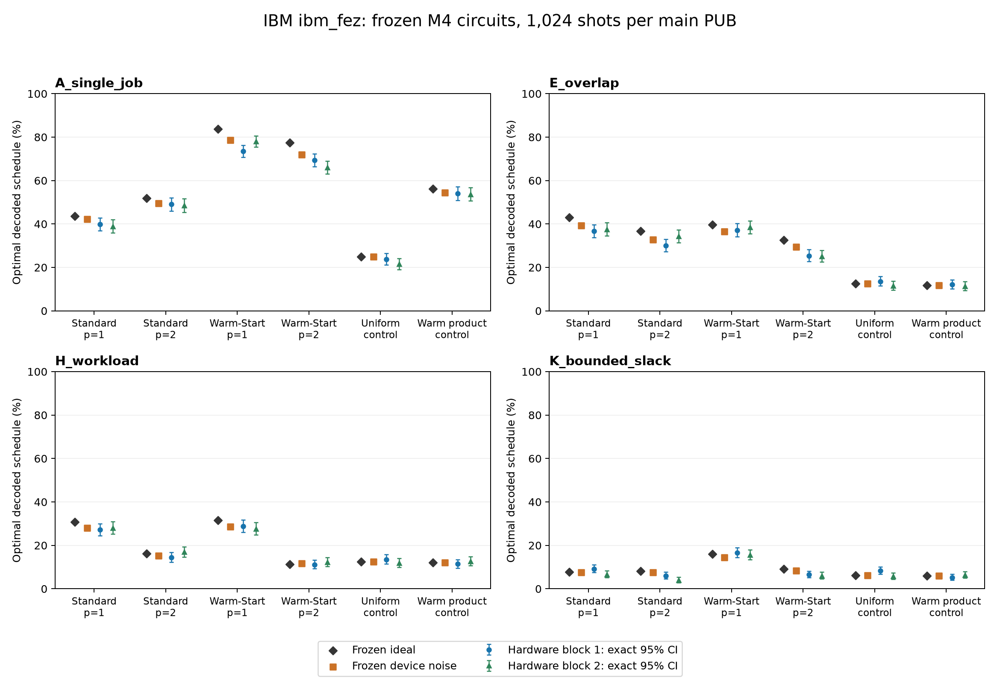

# M5 — ausgeführte IBM-Hardwarekampagne

Stand: 12.10.2026 22:57:31 CEST. **M5 PASS.** Drei genehmigte Jobs auf `ibm_fez` sind abgeschlossen, alle 52 PUBs und 49.664 Shots vollständig gesichert. Datenverträge, technische Smoke-Prüfung, Nutzung, wissenschaftliche Analyse und Acceptance bestehen. Das technische PASS ist kein Nachweis allgemeiner Modellgüte oder Quantum Advantage.

Branch `codex/m5-execution-gates-fix`, unveränderter Ausführungs-HEAD `bc6c46341266e307de78c78fb302bd091ee9e9d0`, Codecommit `880705ce98358787e5f1a7892ab81464873879d6`. Planhash `2eb423c2403cd73aa4104c83eb5fce0d29c950fdb0377501dcca1a9df4c4e6a5`. Kein Push oder Merge. Die nachfolgend neuen Bericht-/Daten-/Abbildungsdateien sind lokal noch nicht committet.

## Ausführung und Budget

| Stufe | Provider-Job-ID | Status | PUBs | Shots | Gemessene QPU-s | Obergrenze s |
| --- | --- | --- | ---: | ---: | ---: | ---: |
| smoke | `db6kfnamb58s738bv8jg` | DONE / COLLECTED | 4 | 512 | 2 | 20 |
| main-block-1 | `db6kgn2mb58s738bv9ig` | DONE / COLLECTED | 24 | 24,576 | 9 | 80 |
| main-block-2 | `db6khk04qg6s73c4ukj0` | DONE / COLLECTED | 24 | 24,576 | 9 | 80 |

Gesamt 20 gemessene QPU-Sekunden, Kampagnenlimit 180, verbleibender Kampagnenrahmen 160 Sekunden. Die maximale Reservierung bleibt 180 Sekunden; gemessene Nutzung, Reservierung, Queue-/Wandzeit und Schätzung sind verschiedene Größen. Konservative eingefrorene Schätzung unverändert 10,162151680 / 67,832596480 / 67,832596480 Sekunden. Keine Ersatzjobs oder Wiederholungsrequests. Jeder Submit genau einmal, jeweils erst nach gültiger Vorgänger-Collection.

Die finalen lesenden IBM-Daten (12.10.2026 22:57:31 CEST) belegen `open/free`, 0 EUR, 600 Sekunden Limit, 20 Sekunden Verbrauch und **580 Sekunden Restkontingent**. `usage_limit_reached=false`; vollständige Inventur mit null offenen oder unklaren Jobs. Das separate SDK-Feld `time_available` bleibt unbekannt; Restkontingent wird aus belegtem Limit minus Verbrauch abgeleitet.

| Vor Einreichung | Beobachtet UTC | Rest s | Verbrauch s | Offene Jobs | Gerätebindung |
| --- | --- | ---: | ---: | ---: | --- |
| smoke | 2026-10-12T20:49:32.798721+00:00 | 600 | 0 | 0 | PASS |
| main_block_1 | 2026-10-12T20:51:38.287251+00:00 | 598 | 2 | 0 | PASS |
| main_block_2 | 2026-10-12T20:53:34.343198+00:00 | 589 | 11 | 0 | PASS |

Die gleiche ausdrücklich gebundene kostenlose Instanz blieb erhalten. Vor jedem Job bestanden frische Geräte-, Target-Timing-, Mapping-, QPY-, Optionen-, Kontingent- und Nutzungsprüfungen. Layout `[0,1,2,3,4,16,5]`; keine Neukompilierung, neuen Winkel, geänderten Schaltungen oder Referenzen. Die eingefrorenen Planflags `hardware_enabled=false` und `submission_approved=false` bleiben erhalten; der Ledger dokumentiert die tatsächlich autorisierte Ausführung separat.

Die persönliche lokale Freigabe enthält Florians Eintrag vom `2026-10-12T20:46:56.4280646Z` und bindet diesen exakten Plan. Der Agent ergänzte ausschließlich die fehlenden JSON-Anführungszeichen um den bereits persönlich eingetragenen Namen und Zeitstempel. Originaleingabe und Syntaxreparatur sind getrennt archiviert. Keine Signaturwerte wurden erfunden. Die Budgetautorisierung bleibt separat.

## Wissenschaftliche Befunde

Alle 48 Haupt-PUBs haben eine beste tatsächlich gemessene gültige Planung mit Gap 0 zum bewiesenen M1-Optimum. Diese Aussage betrifft das beste beobachtete Sample; sie bedeutet weder perfekte Erfolgswahrscheinlichkeit noch einen Laufzeitvorteil.

Das gerätebezogene Noise-Modell liegt bei allen 32 QAOA-PUBs näher am gemessenen Registerhistogramm als die ideale Vorhersage. Dennoch liegen 31 von 32 QAOA-Histogrammdistanzen oberhalb ihrer jeweiligen 97,5-%-Quantile aus reinen Multinomial-Shot-Schwankungen. Bei den 16 Startkontrollen liegt keine Distanz darüber. Die mediane QAOA-Distanz zum Noise-Modell beträgt 0.140605. Diese deskriptiven Vergleiche sind kein gemeinsamer Signifikanztest und keine Zustandsfidelity.

Ein deutlicher negativer Befund ist K / Standard p=2, Block 2: Noise-TV 0,341954 gegenüber Shot-Referenzquantile 0,137459. Grundzustand des vollständigen QUBO: 6/1024 = 0,586 %. Optimale decodierte Planung: 41/1024 = 4,004 %, exaktes 95-%-Intervall [2,888;5,393] %, gegenüber Noise-Vorhersage 7,518 %. Die unterschiedlichen Ereignisse bleiben getrennt.

Warm-Start p=1 erreicht auf A, E und K in beiden Blöcken höhere optimale Planhäufigkeiten als Standard p=1. Auf H wechselt die Reihenfolge zwischen den Blöcken. Bei p=2 ist Warm-Start auf E und H schlechter als Standard. Bei allen vier Warm-Start-Fällen sinkt die beobachtete optimale Planhäufigkeit von p=1 auf p=2; bei Standard steigt diese Häufigkeit nur auf A. Andere Metriken, insbesondere die Offset-Energie, können sich dabei anders entwickeln. Das trägt keinen allgemeinen Warm-Start-Vorteilsnachweis.

## Hauptblöcke einzeln

Alle Wahrscheinlichkeiten sind Prozentwerte. G = Grundzustand des vollständigen QUBO, O = optimale decodierte Mitarbeiterplanung, V = gültige Mitarbeiterplanung, E = Encoding-Feasibility. `O [95%]` nennt das exakte Clopper-Pearson-Intervall je PUB mit 1.024 Shots. Energie enthält den QUBO-Offset; ungültige Bitstrings bleiben enthalten. Alle vier Ereignisintervalle und sämtliche gemessenen besten Planungen stehen im maschinenlesbaren Bericht.

### Hauptblock 1

| Fall / Variante | G % | O % [95%] | V % | E % | Offset-Energie | Bestvalid-Gap | Noise-TV |
| --- | ---: | --- | ---: | ---: | ---: | ---: | ---: |
| A / Standard p=1 | 39.844 | 39.844 [36.829;42.917] | 39.844 | 39.844 | 2.827148 | 0 | 0.126802 |
| A / Standard p=2 | 49.023 | 49.023 [45.919;52.133] | 49.023 | 49.023 | 1.510742 | 0 | 0.094637 |
| A / Uniform-Kontrolle | 23.828 | 23.828 [21.248;26.559] | 23.828 | 23.828 | 4.611328 | 0 | 0.017487 |
| A / Warm-Produkt-Kontrolle | 54.004 | 54.004 [50.895;57.090] | 54.004 | 54.004 | 2.426758 | 0 | 0.014319 |
| A / Warm-Start p=1 | 73.535 | 73.535 [70.719;76.215] | 73.535 | 73.535 | 1.416016 | 0 | 0.050587 |
| A / Warm-Start p=2 | 69.434 | 69.434 [66.510;72.245] | 69.434 | 69.434 | 1.004883 | 0 | 0.049682 |
| E / Standard p=1 | 36.719 | 36.719 [33.759;39.755] | 51.758 | 51.758 | 14.796875 | 0 | 0.112107 |
| E / Standard p=2 | 29.980 | 29.980 [27.186;32.890] | 45.605 | 45.605 | 16.136719 | 0 | 0.140712 |
| E / Uniform-Kontrolle | 13.574 | 13.574 [11.535;15.826] | 19.531 | 19.531 | 25.651367 | 0 | 0.043938 |
| E / Warm-Produkt-Kontrolle | 12.207 | 12.207 [10.264;14.370] | 18.652 | 18.652 | 23.563477 | 0 | 0.059244 |
| E / Warm-Start p=1 | 37.207 | 37.207 [34.238;40.250] | 49.805 | 49.805 | 14.065430 | 0 | 0.097563 |
| E / Warm-Start p=2 | 25.391 | 25.391 [22.750;28.174] | 37.891 | 37.891 | 16.894531 | 0 | 0.133818 |
| H / Standard p=1 | 19.727 | 27.148 [24.445;29.984] | 35.156 | 25.879 | 24.241211 | 0 | 0.159197 |
| H / Standard p=2 | 11.621 | 14.453 [12.355;16.758] | 16.406 | 11.816 | 24.012695 | 0 | 0.276083 |
| H / Uniform-Kontrolle | 6.250 | 13.477 [11.444;15.722] | 19.336 | 9.375 | 36.497070 | 0 | 0.071243 |
| H / Warm-Produkt-Kontrolle | 8.594 | 11.426 [9.542;13.535] | 18.457 | 11.328 | 33.776367 | 0 | 0.061935 |
| H / Warm-Start p=1 | 23.926 | 28.809 [26.050;31.689] | 41.016 | 32.617 | 22.844727 | 0 | 0.122604 |
| H / Warm-Start p=2 | 8.203 | 11.133 [9.271;13.221] | 11.816 | 8.496 | 27.130859 | 0 | 0.296695 |
| K / Standard p=1 | 0.781 | 9.180 [7.482;11.116] | 21.777 | 3.711 | 121.382812 | 0 | 0.186461 |
| K / Standard p=2 | 0.684 | 6.055 [4.673;7.695] | 17.480 | 5.371 | 111.833008 | 0 | 0.336977 |
| K / Uniform-Kontrolle | 1.855 | 8.301 [6.684;10.162] | 20.508 | 4.102 | 131.709961 | 0 | 0.144544 |
| K / Warm-Produkt-Kontrolle | 1.270 | 5.273 [3.986;6.825] | 21.484 | 4.688 | 138.350586 | 0 | 0.135664 |
| K / Warm-Start p=1 | 3.320 | 16.602 [14.372;19.025] | 21.387 | 5.176 | 116.577148 | 0 | 0.200733 |
| K / Warm-Start p=2 | 0.488 | 6.543 [5.106;8.235] | 19.629 | 5.469 | 118.054688 | 0 | 0.307849 |

### Hauptblock 2

| Fall / Variante | G % | O % [95%] | V % | E % | Offset-Energie | Bestvalid-Gap | Noise-TV |
| --- | ---: | --- | ---: | ---: | ---: | ---: | ---: |
| A / Standard p=1 | 38.965 | 38.965 [35.964;42.029] | 38.965 | 38.965 | 2.779297 | 0 | 0.113130 |
| A / Standard p=2 | 48.535 | 48.535 [45.433;51.646] | 48.535 | 48.535 | 1.526367 | 0 | 0.096591 |
| A / Uniform-Kontrolle | 21.484 | 21.484 [19.005;24.129] | 21.484 | 21.484 | 4.735352 | 0 | 0.035065 |
| A / Warm-Produkt-Kontrolle | 53.711 | 53.711 [50.601;56.799] | 53.711 | 53.711 | 2.385742 | 0 | 0.020361 |
| A / Warm-Start p=1 | 78.125 | 78.125 [75.465;80.622] | 78.125 | 78.125 | 1.249023 | 0 | 0.029006 |
| A / Warm-Start p=2 | 66.016 | 66.016 [63.023;68.916] | 66.016 | 66.016 | 1.240234 | 0 | 0.075072 |
| E / Standard p=1 | 37.598 | 37.598 [34.621;40.645] | 53.613 | 53.613 | 14.444336 | 0 | 0.133085 |
| E / Standard p=2 | 34.277 | 34.277 [31.370;37.275] | 48.438 | 48.438 | 16.138672 | 0 | 0.114934 |
| E / Uniform-Kontrolle | 11.523 | 11.523 [9.632;13.639] | 17.383 | 17.383 | 26.382812 | 0 | 0.055649 |
| E / Warm-Produkt-Kontrolle | 11.328 | 11.328 [9.451;13.430] | 16.504 | 16.504 | 23.859375 | 0 | 0.051269 |
| E / Warm-Start p=1 | 38.477 | 38.477 [35.485;41.535] | 51.367 | 51.367 | 13.829102 | 0 | 0.087636 |
| E / Warm-Start p=2 | 25.098 | 25.098 [22.468;27.871] | 37.402 | 37.402 | 16.741211 | 0 | 0.140499 |
| H / Standard p=1 | 18.457 | 28.027 [25.294;30.888] | 36.523 | 25.195 | 24.563477 | 0 | 0.181261 |
| H / Standard p=2 | 13.477 | 16.895 [14.648;19.333] | 18.359 | 13.867 | 23.863281 | 0 | 0.292501 |
| H / Uniform-Kontrolle | 6.445 | 11.914 [9.993;14.057] | 17.773 | 8.789 | 38.661133 | 0 | 0.078190 |
| H / Warm-Produkt-Kontrolle | 7.617 | 12.695 [10.717;14.891] | 20.117 | 10.547 | 33.224609 | 0 | 0.063708 |
| H / Warm-Start p=1 | 22.266 | 27.637 [24.916;30.486] | 38.379 | 30.469 | 22.725586 | 0 | 0.152812 |
| H / Warm-Start p=2 | 8.105 | 12.207 [10.264;14.370] | 12.988 | 8.496 | 27.539062 | 0 | 0.303373 |
| K / Standard p=1 | 0.684 | 6.641 [5.193;8.343] | 19.824 | 2.539 | 116.555664 | 0 | 0.203682 |
| K / Standard p=2 | 0.586 | 4.004 [2.888;5.393] | 17.773 | 6.250 | 114.629883 | 0 | 0.341954 |
| K / Uniform-Kontrolle | 1.074 | 5.762 [4.415;7.370] | 16.406 | 3.320 | 145.849609 | 0 | 0.136765 |
| K / Warm-Produkt-Kontrolle | 2.148 | 6.348 [4.933;8.019] | 20.508 | 4.297 | 134.020508 | 0 | 0.145226 |
| K / Warm-Start p=1 | 3.809 | 15.625 [13.454;17.996] | 21.680 | 6.152 | 115.610352 | 0 | 0.198364 |
| K / Warm-Start p=2 | 0.977 | 6.055 [4.673;7.695] | 17.383 | 5.273 | 113.005859 | 0 | 0.333197 |

## Wiederholungen deskriptiv zusammengefasst

Die folgende Tabelle ist das arithmetische Mittel der beiden separat berichteten Häufigkeiten pro identischer Schaltung. Keine Counts, Fälle oder Experimente werden für ein neues Konfidenzintervall gepoolt. Die acht Startkontrollen bleiben getrennte Experimente; ihre vollständigen wiederholten Werte stehen im JSON.

| Fall / QAOA | Ideale O % | Noise O % | Hardware O %, Block 1 | Block 2 | Deskriptives Mittel |
| --- | ---: | ---: | ---: | ---: | ---: |
| A / Standard p=1 | 43.656 | 42.241 | 39.844 | 38.965 | 39.404 |
| A / Standard p=2 | 51.827 | 49.579 | 49.023 | 48.535 | 48.779 |
| A / Warm-Start p=1 | 83.674 | 78.594 | 73.535 | 78.125 | 75.830 |
| A / Warm-Start p=2 | 77.409 | 72.028 | 69.434 | 66.016 | 67.725 |
| E / Standard p=1 | 43.045 | 39.312 | 36.719 | 37.598 | 37.158 |
| E / Standard p=2 | 36.762 | 32.745 | 29.980 | 34.277 | 32.129 |
| E / Warm-Start p=1 | 39.756 | 36.512 | 37.207 | 38.477 | 37.842 |
| E / Warm-Start p=2 | 32.631 | 29.368 | 25.391 | 25.098 | 25.244 |
| H / Standard p=1 | 30.738 | 27.933 | 27.148 | 28.027 | 27.588 |
| H / Standard p=2 | 16.266 | 15.298 | 14.453 | 16.895 | 15.674 |
| H / Warm-Start p=1 | 31.603 | 28.620 | 28.809 | 27.637 | 28.223 |
| H / Warm-Start p=2 | 11.316 | 11.763 | 11.133 | 12.207 | 11.670 |
| K / Standard p=1 | 7.653 | 7.470 | 9.180 | 6.641 | 7.910 |
| K / Standard p=2 | 8.107 | 7.518 | 6.055 | 4.004 | 5.029 |
| K / Warm-Start p=1 | 15.972 | 14.359 | 16.602 | 15.625 | 16.113 |
| K / Warm-Start p=2 | 9.121 | 8.313 | 6.543 | 6.055 | 6.299 |

## Tatsächliche Prüfungen und Erhaltung

In dieser Ausführung: drei tatsächliche `submit-next`-Aufrufe mit frischem lesendem Preflight, drei tatsächliche `collect`-Aufrufe, wiederholte lokale Gleichheits-/Mapping-/Historienprüfungen durch den CLI-Pfad, `analyze` und `acceptance` mit explizitem V2-Toolingpfad, anschließend nur lesende Abschlussbestätigung mit gesperrten Hardware-Entry-Points. Alle Aufrufe erfolgreich; kein unbegrenztes Polling und kein Submit-Retry.

Die bereits tatsächlich ausgeführten Qualitätsprüfungen für denselben unveränderten Sourcekontext sind weiterhin gebunden: 197 gezielte Tests, 1741 vollständige Tests, Ruff/Format/mypy und Offline-Build bestanden. Diese komplette Suite wurde in der Hardwareausführung nicht nochmals gestartet. Es gab keine Source-/Dependencyänderung; lediglich neue Mess-/Berichtsartefakte. Die historischen Fehlversuche und Offline-/BLOCKED-Berichte bleiben erhalten.

Die unabhängige lokale Abschlussreview bestätigte 138 Source-Bindungen, alle 84 QPY-Rohhashes und 4176 geschützte M1–M4-Dateien unverändert; Ledger, Raw, Analyse und Acceptance konsistent. Die wissenschaftliche Review rechnete alle 192 exakten Ereignisintervalle, vier Metriken je PUB, Offset-Energie, Bestvalid-Gaps und TV-Vergleiche unabhängig nach. Der ursprüngliche Checkout bleibt auf `bad2b09714209df3ccccbbab6d7fd408becc2e36`; die zwei alten ungetrackten Berichte bleiben unverändert.

Acceptance: Implementierung PASS, Approval-Evidence verifiziert, 3/3 Hardwarejobs, 52/52 echte PUBs, Rohdaten vollständig, 48 Haupt-PUBs in zwei getrennten Blöcken ANALYZED, tatsächliche Usage 20/180 Sekunden, keine Gate-Diagnosen. Der dort gelesene Preflightcache ist eine historische Beobachtung; die gesonderte frische Abschlussbestätigung belegt das aktuelle Kontingent.

## Grenzen und Artefakte

Noise erfasst Idle-Zeitpläne, Crosstalk und Drift unvollständig; die Readoutapproximation bleibt symmetrisch. Binomiale Intervalle und Multinomial-Referenzen nehmen unabhängige Shots an. Zwei Wiederholungen sind kein Langzeitnachweis; vier bekannte Fälle sind keine unabhängige allgemeine Problemsuite. Histogramm-TV ist keine Quantenzustandsfidelity. Keine Readout-Mitigation, Postselection, Decoder-Reparatur, neue Optimierung oder Best-Seed-Auswahl. Negative Ergebnisse und vollständige ungültige Counts bleiben erhalten.

- [Öffentlicher vollständiger Mess-/Metrikbericht](../data/hardware/m5/ibm_fez_campaign_20261012.json): alle 52 rohe Countsätze, Shotzahlen, Mapping, 48 getrennte Analysen, 192 Intervalle, Offsetenergien, beste gültige Planungen, Modellvergleiche und Herkunftshashes.
- JSON-Seal: `c92ef4a57cee69d4221c664641337005be0e5aabf0ff8ac8677adddf539cea95`.
- [Vergleichsabbildung als PDF](../data/hardware/m5/optimal_schedule_comparison_20261012.pdf).
- [Vorhandene M5-Acceptance](../results/m5-execution-gates-fix-20261012-v2/provider/m5-acceptance.json).
- [Originales Raw-Collect](../results/m5-execution-gates-fix-20261012-v2/provider/raw/collected.json).
- [Originale vollständige Analyse](../results/m5-execution-gates-fix-20261012-v2/provider/summaries/analysis.json).
- [Einreichungsledger](../results/m5-execution-gates-fix-20261012-v2/provider/jobs/ledger.json).
- [Frische lesende Abschlussbestätigung](../results/m5-authorized-execution-20261012-v1/final_readonly_confirmation.json).
- Lokales Auditarchiv `results/m5-authorized-execution-20261012-v1`: Originalauftrag, Freigabeprüfung, unveränderte Vorbereitungs-/Readinessdateien, Aufruflogs und Zustände nach jedem Job. Dieses Archiv und die bisherige Ergebnishistorie bleiben erhalten.
